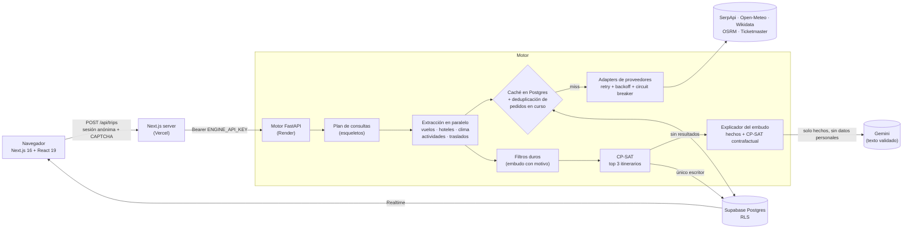

# TravelOpt: optimizador de itinerarios multi-ciudad

**Encuentra el viaje multi-destino más barato que cumple todas tus condiciones, con precios reales, y explica por qué.**

Planear un viaje de 12 noches por dos o tres ciudades para una familia es un problema combinatorio. Hay que elegir
fechas de salida, aeropuertos, vuelos por tramo, cómo repartir las noches entre ciudades, qué combinación de habitaciones
o departamentos alcanza para el grupo y en qué día va cada actividad según el clima. Los buscadores comparan piezas
sueltas; TravelOpt optimiza el viaje completo y devuelve las 3 mejores combinaciones de fechas, con el costo conciliado
al centavo y cada opción descartada con su motivo.

- **Demo en vivo:** https://travelopt-rho.vercel.app (beta: Costa Este de EE. UU.)
- **Caso de referencia:** Buenos Aires → Orlando → Nueva York, 5 viajeros, 12 noches. Óptimo verificado:
  **USD 20,083.62**, el mismo con CP-SAT y con un oráculo de fuerza bruta.

---

## El núcleo matemático: investigación operativa con CP-SAT

El motor modela el viaje como un problema de **satisfacción y optimización de restricciones** y lo resuelve con
**Google OR-Tools CP-SAT**:

1. **Esqueletos.** Se enumeran los órdenes de ciudades, las fechas de salida y los repartos de noches factibles, y se
   comparten los subproblemas que se repiten entre esqueletos.
2. **Restricciones duras como filtros con motivo:** escalas máximas, horarios de salida y llegada, asientos para todo el
   grupo, baños y dormitorios mínimos, estadía mínima, **legalidad del alquiler temporario por ciudad**, cocina exigida
   y clima para actividades al aire libre. Nada se relaja en silencio: cada descarte queda registrado en un *embudo de
   factibilidad* que la interfaz muestra.
3. **Subproblemas CP-SAT.** El alojamiento elige la combinación más barata de unidades que cubre capacidad, baños y
   dormitorios. Las actividades asignan cada imperdible a un día respetando el clima, la capacidad diaria y los días
   completos seguidos.
4. **Determinismo.** Corre con `num_workers = 1` y desempates explícitos: misma entrada, misma salida. Un **oráculo de
   fuerza bruta** valida que los modelos CP-SAT devuelvan el óptimo exacto.
5. **Dinero exacto.** Todos los montos son `int` en centavos, nunca `float`. Los impuestos van en *basis points* con
   redondeo half-up por línea, y el total y el reparto por persona concilian al centavo.

## Explicador del embudo (IA sin alucinaciones)

Cuando ninguna combinación cumple las condiciones, un "sin resultados" seco hace que la persona abandone sin saber qué
cambiar. El explicador le dice **por qué** no hubo viaje y **qué cambio concreto lo destraba**: "7 vuelos tenían más
escalas que tu máximo; si aceptás 1 escala por tramo, el mejor itinerario cuesta USD 20,083.62". El número no lo
calcula el LLM: el motor vuelve a correr CP-SAT con cada restricción aflojada un paso, sobre las mismas ofertas y sin
consumir cuota de proveedores.

El LLM (Gemini, tier gratuito) **no es un chatbot**: recibe solo un JSON de "hechos del embudo" sin datos personales y
lo traduce a español. Antes de mostrarse, un control de integridad verifica que cada número y cada código del texto
estén en esos hechos. Si el modelo inventa algo, tarda más de 8 s, da límite de uso o no hay clave, se muestra la misma
explicación armada por plantillas. La persona nunca ve un error ni un dato inventado.

## Arquitectura



- **El motor es el único que escribe en la base.** El navegador solo lee lo suyo (Row Level Security por `auth.uid()`).
  Aunque alguien manipule el cliente, no puede alterar precios ni resultados.
- **Orquestación intercambiable.** El mismo flujo corre como workflows de **n8n** (local) o en proceso dentro del motor
  (`ORCHESTRATOR=inprocess`, producción a costo cero).
- **Patrón Adapter.** Cada proveedor traduce su respuesta al modelo canónico (Pydantic). El optimizador nunca ve JSON
  crudo de un proveedor.

## Stack

| Capa | Tecnología |
|---|---|
| Frontend | Next.js 16 (App Router), React 19, TypeScript estricto, Tailwind CSS 4, Leaflet, zod, lucide-react |
| Backend | Python 3.12, FastAPI, Pydantic 2, asyncio, httpx, psycopg 3 (async + pool) |
| Optimización | Google OR-Tools CP-SAT |
| Datos | Supabase (Postgres, RLS, Realtime), migraciones versionadas, pgTAP |
| Orquestación | n8n (local) / orquestador en proceso (producción) |
| Calidad | pytest, Vitest, Playwright + axe-core, pgTAP, mypy, ruff, ESLint |
| CI/CD | GitHub Actions (engine · database · web · secrets con gitleaks), Vercel, Render Blueprint |

## Highlights de ingeniería

- **Costo cero en producción.** Vercel Hobby, Render Free, Supabase Free y UptimeRobot. Con una cuota de SerpApi de 250
  búsquedas por mes: caché primero con TTL por tipo de dato, tope de búsquedas por corrida, medidor de cuota con reserva
  y **modo histórico**. Con la cuota agotada se sirve el último precio real guardado, marcado "Cotizado hace X". Nunca
  un precio inventado.
- **Deduplicación de pedidos (request collapsing).** Pedidos idénticos simultáneos comparten una sola llamada externa.
  La llamada corre en una tarea propia y cada pedido espera con `asyncio.shield`: si se cancela el primero, los demás
  no quedan colgados. Hay tests de cancelación y de estrés con 3.000 pedidos concurrentes.
- **Resiliencia.** Reintentos con *backoff* y jitter, respetando `Retry-After`. **Circuit breaker** por proveedor (se
  abre tras 5 fallas seguidas, 30 s de enfriamiento y prueba semiabierta). Timeout de 4 s para APIs no críticas.
  Degradación elegante: si fallan el clima o las actividades, el itinerario sale igual con aviso.
- **Cold start.** El plan gratuito duerme el motor a los 15 minutos sin uso. Hay un *warm-up* al abrir el formulario,
  un aviso de arranque y una pantalla de espera que muestra el recorrido y datos de los destinos sin esperar al motor.
- **Incertidumbre modelada de forma explícita.** Si un dato no se sabe (cocina en un hotel, zona horaria de un
  aeropuerto, precio de una entrada), queda como `None` y no se supone. Una restricción dura solo acepta datos
  verificados.
- **Husos horarios.** Horario local para la interfaz y las reglas, y además el instante UTC y la duración real del vuelo
  (tabla estática de 7.917 aeropuertos). Un vuelo con duración ≤ 0 se descarta como dato roto.
- **Privacidad y legalidad.** Sesiones anónimas con CAPTCHA (Cloudflare Turnstile), sin registro. Las búsquedas se
  borran solas a los 30 días (Ley 25.326, minimización de datos). Las alertas operativas pasan por una lista blanca de
  campos, sin datos personales. Reglas de **alquiler temporario por ciudad** (por ejemplo, NYC Local Law 18: menos de
  30 noches solo con anfitrión registrado): el alquiler que no puede ser legal se descarta y quedan los hoteles.
- **Seguridad (OWASP).** CSP con nonce por request y `strict-dynamic`. Lista blanca de hosts de salida contra SSRF. Links
  externos saneados. Rate limits por usuario y globales en Postgres. Ningún secreto en variables `NEXT_PUBLIC_`.
- **Accesibilidad.** Auditada con axe-core (WCAG 2.1 AA) en los E2E. Las ayudas funcionan con mouse, teclado y toque.

Las prácticas siguen los criterios de calidad de ISO/IEC 25010 y de seguridad de ISO/IEC 27001 como guía de diseño.
El proyecto **no** está certificado.

## Correrlo en local

**Requisitos:** Python 3.12 con [uv](https://docs.astral.sh/uv/), Node.js 22 o superior, y Docker (para Supabase local).

```bash
git clone https://github.com/<tu-usuario>/travelopt.git
cd travelopt
cp .env.example .env            # completar ENGINE_API_KEY con un secreto propio (mín. 24 caracteres)
```

**1. Base de datos** (Supabase local en Docker, con migraciones y datos de prueba):

```bash
npx supabase start
npx supabase db reset           # aplica supabase/migrations/
npx supabase status             # muestra la URL y la publishable key locales
```

**2. Motor:**

```bash
cd engine
uv sync
uv run uvicorn app.api.main:app --reload --port 8000
```

En Windows usá siempre `--reload`: así uvicorn usa un event loop compatible con psycopg async.

**3. Web:** creá `web/.env.local` con la sección "Web" de `.env.example` y la URL y la publishable key que mostró
`npx supabase status`.

```bash
cd web
npm install
npm run dev                     # http://localhost:3000
```

Con `DEFAULT_MODE=fixture` no hace falta ninguna clave externa: el caso Orlando + Nueva York usa datos de prueba. Para
precios reales: `DEFAULT_MODE=hybrid` y `SERPAPI_API_KEY`.

**Tests:**

```bash
cd engine && uv run pytest -q          # motor (incluye el caso golden)
cd web && npm test                     # unitarios
cd web && npx playwright test          # E2E + accesibilidad (requiere motor y Supabase corriendo)
npx supabase test db                   # pgTAP: RLS y funciones de la base
uv run --project engine python scripts/gate.py 3   # gate de calidad: tests, ruff, mypy
```

## Documentación

- [Resumen de arquitectura](docs/architecture_phase1_summary.md): diseño del sistema, decisiones y trade-offs.
- [`master_plan.md`](master_plan.md): roadmap por fases y estado.
- [`project_guidelines.md`](project_guidelines.md): normas del proyecto y registro de decisiones.
- [`docs/adr/0001-proveedores.md`](docs/adr/0001-proveedores.md): elección de proveedores de datos.

## Cómo se construyó

Desarrollado con asistencia de IA (Claude Code). Las decisiones de producto y arquitectura, la definición de reglas y
la validación en producción fueron del autor. Cada fase tuvo un *gate* automático (tests, tipado, lint) y checks
manuales antes de avanzar a la siguiente.
