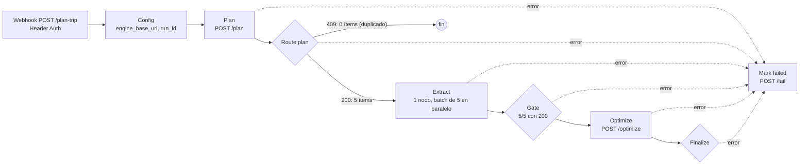

# Fase 2: orquestación con n8n

**Objetivo:** que n8n sea el **control plane**. Recibe el disparo del motor y llama a `/plan`, a las 5 extracciones **en paralelo** y a `/optimize`. Además maneja todos los caminos de error y limpia las corridas colgadas.
**Requisito previo:** `GATE FASE 1: OK`, motor levantado en `localhost:8000` con `DATABASE_URL` local.
**Salida:** WF-01, WF-02 y WF-03 importados, probados y versionados en `n8n/workflows/`.

> **Esperado en esta fase:** el flujo completo termina en `failed` con `node: "Finalize"` porque `/optimize` todavía responde 501. Eso valida el camino de error. En la Fase 3 el mismo flujo termina en `done`.

---

## 2.1 Diseño

**Qué hace n8n:** secuencia, paralelismo, reintentos de transporte, enrutamiento de errores y tareas programadas.
**Qué no hace:** no transforma datos de proveedores, no toca Supabase y no conoce credenciales de la base. Su única credencial de backend es `ENGINE_API_KEY`.



| Nodo | Tipo | Configuración clave | Si falla |
|---|---|---|---|
| Webhook | Webhook v2 | `POST /plan-trip`, Header Auth (`X-Webhook-Secret`), responde al recibir | 401/403 al emisor |
| Config | Set v3.4 | `engine_base_url` es un **literal** (`http://host.docker.internal:8000`; los nodos no leen `$env`), `run_id` **se valida** con regex de UUID y queda vacío si no coincide, `debug_delay_ms` | — |
| Plan | HTTP v4.2 | `fullResponse` + `neverError`; 3 intentos cada 2 s | Salida de error → Mark failed |
| Route plan | Code | 200 → 5 ítems · 409 → `[]` (corta en silencio) · otro → `throw` | Salida de error → Mark failed |
| Extract | HTTP v4.2 | **Un solo nodo con 5 ítems y batch de 5 = concurrente**; timeout 120 s; 3 intentos cada 3 s (solo si el motor no responde) | Salida de error → Mark failed |
| Gate | Code | Exige 5 de 5 con 200; si no, `throw extraction_failed` | Salida de error → Mark failed |
| Optimize | HTTP v4.2 | Timeout 180 s; 2 intentos | Salida de error → Mark failed |
| Finalize | Code | 200 → resumen · 409 → `[]` · otro → `throw optimize_failed` | Salida de error → Mark failed |
| Mark failed | HTTP v4.2 | `POST /fail {code, node: $prevNode.name, message}` | Continúa: si el motor está caído, actúa el reaper |

**Por qué un nodo con 5 ítems y no 5 ramas:** n8n ejecuta las ramas una tras otra. El nodo HTTP, en cambio, envía en paralelo los ítems de un mismo batch. CP-2.3 lo mide.

**Por qué `neverError` + nodos Code:** los reintentos de proveedor ya los hace el motor, con backoff y `Retry-After`. Si n8n también reintentara ante un 5xx del motor, las llamadas se multiplicarían. Con `neverError`, n8n solo reintenta cuando el motor no responde (red caída o timeout), y los nodos Code deciden según el status HTTP.

## 2.2 Credenciales

En n8n, *Credentials → New → Header Auth*:

| Nombre | Header | Valor |
|---|---|---|
| `Webhook secret` | `X-Webhook-Secret` | valor de `N8N_WEBHOOK_SECRET` del `.env` |
| `Engine API key` | `Authorization` | `Bearer ` + valor de `ENGINE_API_KEY` |

## 2.3 Workflows

**`n8n/workflows/wf01_plan_trip.json`**

```json
{
  "name": "WF-01 plan-trip",
  "nodes": [
    {
      "parameters": {
        "httpMethod": "POST",
        "path": "plan-trip",
        "authentication": "headerAuth",
        "responseMode": "onReceived",
        "options": {}
      },
      "id": "0b7c6f8e-1a01-4c3e-9a10-000000000001",
      "name": "Webhook",
      "type": "n8n-nodes-base.webhook",
      "typeVersion": 2,
      "position": [0, 0],
      "webhookId": "5d1f3a2c-7b44-4f0e-8e21-0a1b2c3d4e01",
      "credentials": { "httpHeaderAuth": { "id": "REEMPLAZAR", "name": "Webhook secret" } }
    },
    {
      "parameters": {
        "assignments": {
          "assignments": [
            { "id": "c1", "name": "engine_base_url", "value": "http://host.docker.internal:8000", "type": "string" },
            { "id": "c2", "name": "run_id", "value": "={{ String($json.body.run_id ?? '').match(/^[0-9a-f-]{36}$/i)?.[0] ?? '' }}", "type": "string" },
            { "id": "c3", "name": "debug_delay_ms", "value": "={{ $json.body.debug_delay_ms ?? 0 }}", "type": "number" }
          ]
        },
        "options": {}
      },
      "id": "0b7c6f8e-1a01-4c3e-9a10-000000000002",
      "name": "Config",
      "type": "n8n-nodes-base.set",
      "typeVersion": 3.4,
      "position": [220, 0]
    },
    {
      "parameters": {
        "method": "POST",
        "url": "={{ $json.engine_base_url }}/v1/runs/{{ $json.run_id }}/plan",
        "authentication": "genericCredentialType",
        "genericAuthType": "httpHeaderAuth",
        "options": {
          "timeout": 30000,
          "response": { "response": { "fullResponse": true, "neverError": true } }
        }
      },
      "id": "0b7c6f8e-1a01-4c3e-9a10-000000000003",
      "name": "Plan",
      "type": "n8n-nodes-base.httpRequest",
      "typeVersion": 4.2,
      "position": [440, 0],
      "retryOnFail": true,
      "maxTries": 3,
      "waitBetweenTries": 2000,
      "onError": "continueErrorOutput",
      "credentials": { "httpHeaderAuth": { "id": "REEMPLAZAR", "name": "Engine API key" } }
    },
    {
      "parameters": {
        "jsCode": "// fullResponse: { statusCode, body, headers }\nconst r = $input.first().json;\nif (r.statusCode === 409) return [];  // webhook duplicado: otra ejecución ya tomó la corrida\nif (r.statusCode !== 200) throw new Error(`plan_failed: ${r.statusCode} ${JSON.stringify(r.body).slice(0, 300)}`);\nreturn r.body.tasks.map(t => ({ json: t }));  // 5 ítems: flights, lodging, activities, weather, transport"
      },
      "id": "0b7c6f8e-1a01-4c3e-9a10-000000000004",
      "name": "Route plan",
      "type": "n8n-nodes-base.code",
      "typeVersion": 2,
      "position": [660, 0],
      "onError": "continueErrorOutput"
    },
    {
      "parameters": {
        "method": "POST",
        "url": "={{ $('Config').first().json.engine_base_url }}/v1/runs/{{ $('Config').first().json.run_id }}/extract/{{ $json.kind }}?delay_ms={{ $('Config').first().json.debug_delay_ms }}",
        "authentication": "genericCredentialType",
        "genericAuthType": "httpHeaderAuth",
        "options": {
          "timeout": 120000,
          "batching": { "batch": { "batchSize": 5, "batchInterval": 0 } },
          "response": { "response": { "fullResponse": true, "neverError": true } }
        }
      },
      "id": "0b7c6f8e-1a01-4c3e-9a10-000000000005",
      "name": "Extract",
      "type": "n8n-nodes-base.httpRequest",
      "typeVersion": 4.2,
      "position": [880, 0],
      "retryOnFail": true,
      "maxTries": 3,
      "waitBetweenTries": 3000,
      "onError": "continueErrorOutput",
      "credentials": { "httpHeaderAuth": { "id": "REEMPLAZAR", "name": "Engine API key" } }
    },
    {
      "parameters": {
        "jsCode": "// Corre una vez con TODOS los ítems de Extract.\nconst expected = $('Route plan').all().length;\nconst items = $input.all();\nconst bad = items.filter(i => i.json.statusCode !== 200);\nif (items.length !== expected || bad.length > 0) {\n  throw new Error('extraction_failed: ' + JSON.stringify(bad.map(i => ({ status: i.json.statusCode, body: i.json.body }))).slice(0, 400));\n}\nreturn [{ json: { run_id: $('Config').first().json.run_id, extractions: items.map(i => i.json.body) } }];"
      },
      "id": "0b7c6f8e-1a01-4c3e-9a10-000000000006",
      "name": "Gate",
      "type": "n8n-nodes-base.code",
      "typeVersion": 2,
      "position": [1100, 0],
      "onError": "continueErrorOutput"
    },
    {
      "parameters": {
        "method": "POST",
        "url": "={{ $('Config').first().json.engine_base_url }}/v1/runs/{{ $('Config').first().json.run_id }}/optimize",
        "authentication": "genericCredentialType",
        "genericAuthType": "httpHeaderAuth",
        "options": {
          "timeout": 180000,
          "response": { "response": { "fullResponse": true, "neverError": true } }
        }
      },
      "id": "0b7c6f8e-1a01-4c3e-9a10-000000000007",
      "name": "Optimize",
      "type": "n8n-nodes-base.httpRequest",
      "typeVersion": 4.2,
      "position": [1320, 0],
      "retryOnFail": true,
      "maxTries": 2,
      "waitBetweenTries": 3000,
      "onError": "continueErrorOutput",
      "credentials": { "httpHeaderAuth": { "id": "REEMPLAZAR", "name": "Engine API key" } }
    },
    {
      "parameters": {
        "jsCode": "const r = $input.first().json;\nif (r.statusCode === 409) return [];  // ya optimizada (reintento)\nif (r.statusCode !== 200) throw new Error(`optimize_failed: ${r.statusCode} ${JSON.stringify(r.body).slice(0, 300)}`);\nreturn [{ json: { run_id: r.body.run_id, status: r.body.status, best_total_minor: r.body.best_total_minor } }];"
      },
      "id": "0b7c6f8e-1a01-4c3e-9a10-000000000008",
      "name": "Finalize",
      "type": "n8n-nodes-base.code",
      "typeVersion": 2,
      "position": [1540, 0],
      "onError": "continueErrorOutput"
    },
    {
      "parameters": {
        "method": "POST",
        "url": "={{ $('Config').first().json.engine_base_url }}/v1/runs/{{ $('Config').first().json.run_id }}/fail",
        "authentication": "genericCredentialType",
        "genericAuthType": "httpHeaderAuth",
        "sendBody": true,
        "specifyBody": "json",
        "jsonBody": "={{ JSON.stringify({ code: 'workflow_error', node: $prevNode.name, message: JSON.stringify($json.error ?? $json).slice(0, 500) }) }}",
        "options": { "timeout": 15000 }
      },
      "id": "0b7c6f8e-1a01-4c3e-9a10-000000000009",
      "name": "Mark failed",
      "type": "n8n-nodes-base.httpRequest",
      "typeVersion": 4.2,
      "position": [1100, 300],
      "retryOnFail": true,
      "maxTries": 3,
      "waitBetweenTries": 2000,
      "onError": "continueRegularOutput",
      "credentials": { "httpHeaderAuth": { "id": "REEMPLAZAR", "name": "Engine API key" } }
    }
  ],
  "connections": {
    "Webhook":    { "main": [[{ "node": "Config", "type": "main", "index": 0 }]] },
    "Config":     { "main": [[{ "node": "Plan", "type": "main", "index": 0 }]] },
    "Plan":       { "main": [[{ "node": "Route plan", "type": "main", "index": 0 }], [{ "node": "Mark failed", "type": "main", "index": 0 }]] },
    "Route plan": { "main": [[{ "node": "Extract", "type": "main", "index": 0 }], [{ "node": "Mark failed", "type": "main", "index": 0 }]] },
    "Extract":    { "main": [[{ "node": "Gate", "type": "main", "index": 0 }], [{ "node": "Mark failed", "type": "main", "index": 0 }]] },
    "Gate":       { "main": [[{ "node": "Optimize", "type": "main", "index": 0 }], [{ "node": "Mark failed", "type": "main", "index": 0 }]] },
    "Optimize":   { "main": [[{ "node": "Finalize", "type": "main", "index": 0 }], [{ "node": "Mark failed", "type": "main", "index": 0 }]] },
    "Finalize":   { "main": [[], [{ "node": "Mark failed", "type": "main", "index": 0 }]] }
  },
  "settings": {
    "executionOrder": "v1"
  },
  "pinData": {},
  "active": false
}
```

**`n8n/workflows/wf02_error_handler.json`**

```json
{
  "name": "WF-02 error-handler",
  "nodes": [
    {
      "parameters": {},
      "id": "1c2d3e4f-0002-4000-8000-000000000001",
      "name": "Error Trigger",
      "type": "n8n-nodes-base.errorTrigger",
      "typeVersion": 1,
      "position": [0, 0]
    },
    {
      "parameters": {
        "jsCode": "const e = $input.first().json;\nreturn [{ json: {\n  workflow: e.workflow?.name,\n  execution_id: e.execution?.id,\n  execution_url: e.execution?.url,\n  last_node: e.execution?.lastNodeExecuted,\n  message: e.execution?.error?.message,\n} }];"
      },
      "id": "1c2d3e4f-0002-4000-8000-000000000002",
      "name": "Format",
      "type": "n8n-nodes-base.code",
      "typeVersion": 2,
      "position": [220, 0]
    },
    {
      "parameters": {},
      "id": "1c2d3e4f-0002-4000-8000-000000000003",
      "name": "Notificar (reemplazar por Email/Slack)",
      "type": "n8n-nodes-base.noOp",
      "typeVersion": 1,
      "position": [440, 0]
    }
  ],
  "connections": {
    "Error Trigger": { "main": [[{ "node": "Format", "type": "main", "index": 0 }]] },
    "Format": { "main": [[{ "node": "Notificar (reemplazar por Email/Slack)", "type": "main", "index": 0 }]] }
  },
  "settings": { "executionOrder": "v1" },
  "pinData": {},
  "active": false
}
```

**`n8n/workflows/wf03_maintenance.json`**

```json
{
  "name": "WF-03 maintenance",
  "nodes": [
    {
      "parameters": { "rule": { "interval": [{ "field": "minutes", "minutesInterval": 5 }] } },
      "id": "2d3e4f5a-0003-4000-8000-000000000001",
      "name": "Cada 5 min",
      "type": "n8n-nodes-base.scheduleTrigger",
      "typeVersion": 1.2,
      "position": [0, 0]
    },
    {
      "parameters": {
        "method": "POST",
        "url": "http://host.docker.internal:8000/v1/maintenance/reap",
        "authentication": "genericCredentialType",
        "genericAuthType": "httpHeaderAuth",
        "options": { "timeout": 15000 }
      },
      "id": "2d3e4f5a-0003-4000-8000-000000000002",
      "name": "Reap stale runs",
      "type": "n8n-nodes-base.httpRequest",
      "typeVersion": 4.2,
      "position": [220, 0],
      "retryOnFail": true,
      "maxTries": 2,
      "waitBetweenTries": 5000,
      "credentials": { "httpHeaderAuth": { "id": "REEMPLAZAR", "name": "Engine API key" } }
    }
  ],
  "connections": {
    "Cada 5 min": { "main": [[{ "node": "Reap stale runs", "type": "main", "index": 0 }]] }
  },
  "settings": { "executionOrder": "v1" },
  "pinData": {},
  "active": false
}
```

**Importar** (UI: *Workflows → Import from File*, uno por uno). Por CLI, el compose monta `./n8n/workflows` en `/workflows` **en solo lectura** (alcanza para importar):

```bash
docker compose exec n8n n8n import:workflow --separate --input=/workflows
```

**Después de importar:**
1. Abrir cada nodo con credencial (Webhook, Plan, Extract, Optimize, Mark failed y Reap stale runs) y elegir la credencial correcta. Los IDs del JSON dicen `REEMPLAZAR`.
2. WF-01 y WF-03 → *Settings → Error workflow* = **WF-02 error-handler**.
3. Publicar o activar WF-01 y WF-03. El webhook de producción (`/webhook/plan-trip`) solo responde con el workflow activo.
4. Si n8n reporta una versión de nodo desconocida, recrear ese nodo con la tabla de §2.1 (los parámetros son los mismos).

## 2.4 Conectar el motor con n8n

En `.env`:

```bash
N8N_WEBHOOK_URL=http://localhost:5678/webhook/plan-trip
```

`N8N_WEBHOOK_SECRET` ya está desde la Fase 0. Reiniciar el motor. Desde ahora, `POST /v1/runs` y `create_fixture_run(trigger=True)` disparan n8n. El contenedor llega al motor por `http://host.docker.internal:8000`, escrito como literal en el nodo Config de WF-01 y en la URL de WF-03 (`N8N_BLOCK_ENV_ACCESS_IN_NODE` está en `true`, así que los workflows no leen variables de entorno). n8n escucha solo en `127.0.0.1:5678`.

## 2.5 MCP de instancia de n8n (opcional)

Para que Claude descubra y ejecute workflows desde n8n:
1. *Settings → Instance-level MCP* → habilitar.
2. En WF-01 → *Settings* → marcarlo como disponible para MCP.
3. Registrarlo con scope local (ver Fase 0, §0.6.3).

Las pruebas de esta fase **no lo requieren**: usan `travelopt-devtools`.

## 2.6 Versionado

Cada cambio en un workflow se exporta y se commitea con el mismo nombre de archivo. El ID está en la URL del editor:

```bash
docker compose exec n8n n8n export:workflow --id=<ID_WF01> --output=/tmp/wf01_plan_trip.json
docker compose cp n8n:/tmp/wf01_plan_trip.json n8n/workflows/wf01_plan_trip.json
```

`/workflows` está montado en solo lectura, por eso se exporta a `/tmp` dentro del contenedor y se copia al host con `docker compose cp`. Repetir con cada workflow.

Nunca exportar credenciales (`export:credentials`). El JSON de un workflow solo contiene referencias a ellas, sin secretos.

---

## Checkpoints de validación (todos deben dar OK)

**Estado previo:** el JSON de los 3 workflows es válido y la lógica de los nodos Code (Route plan, Gate y Finalize, con sus caminos 200, 409 y error) se probó con Node. **No se importaron** en un n8n real: CP-2.1 en adelante es la primera ejecución real.

| ID | Check | Cómo | OK si… |
|---|---|---|---|
| CP-2.1 | Webhook protegido | POST al webhook **sin** el header (comando debajo de la tabla) | 401 o 403 |
| CP-2.2 | Flujo hasta extracción | Claude: `e2e_via_n8n()` | `status: failed`, `error.node = "Finalize"` y `error.message` contiene `optimizer_not_ready`. En `run_offers`: 15/48/99/14/2 (57 antes del catálogo de opcionales de 4b). `timings` tiene `queued` y `extracting` |
| CP-2.3 | **Concurrencia** | 1) `create_fixture_run()` → `run_id`. 2) `n8n_fire_webhook("plan-trip", {"run_id": "<id>", "debug_delay_ms": 2000})`. 3) `n8n_executions(limit=1)` y luego `n8n_execution(<id>)` | En el nodo **Extract**, `ms` entre **2000 y 4000**. Si da ≥ 10000, las llamadas fueron en serie: revisar el batching |
| CP-2.4 | Webhook duplicado | Disparar otra vez el mismo `run_id` | La ejecución termina OK, `Route plan` con 0 ítems de salida y la corrida **no** pasa a `failed` |
| CP-2.5 | Falla de extracción | `create_fixture_run(mode="live")` y disparar el webhook | `failed`, `error.node = "Gate"` y el mensaje contiene `extraction_failed` y 501 |
| CP-2.6 | Motor caído + reaper | 1) Poner `STALE_RUN_SECONDS=60` en `.env` y reiniciar el motor. 2) `create_fixture_run()`. 3) Detener el motor y disparar el webhook. 4) Levantar el motor. 5) Esperar a WF-03 (≤ 5 min) | En la ejecución, Plan agota 3 intentos y Mark failed falla sin cortar el workflow. La corrida termina `failed` con `error.code = "stale_run"`. Después volver `STALE_RUN_SECONDS` a 600 |
| CP-2.7 | Mantenimiento | `n8n_executions(workflow_id=<WF03>)` | Ejecuciones cada 5 min con `success` |
| CP-2.8 | Error workflow asignado | UI: *Settings* de WF-01 y WF-03 | WF-02 seleccionado en ambos |
| CP-2.9 | Versionado | `git status` | Los 3 JSON exportados después de las pruebas, con el nombre de §2.6 |
| CP-2.10 | Gate | `uv run python scripts/gate.py 2` | `GATE FASE 2: OK` |

Comando de CP-2.1 (debe imprimir 401 o 403):

```bash
curl -s -o /dev/null -w "%{http_code}\n" -X POST http://localhost:5678/webhook/plan-trip -H "Content-Type: application/json" -d '{"run_id":"x"}'
```

> Al cerrar: actualizar la tabla *Estado* de `master_plan.md` y hacer un commit `fase-2: gate OK`.
