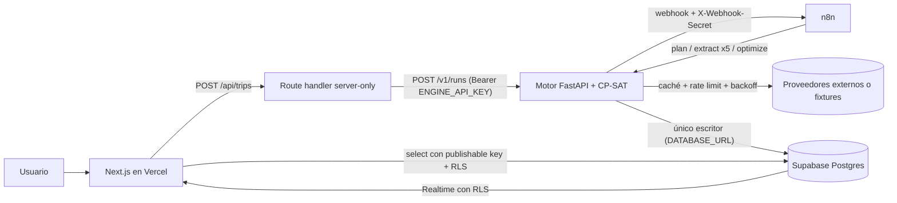
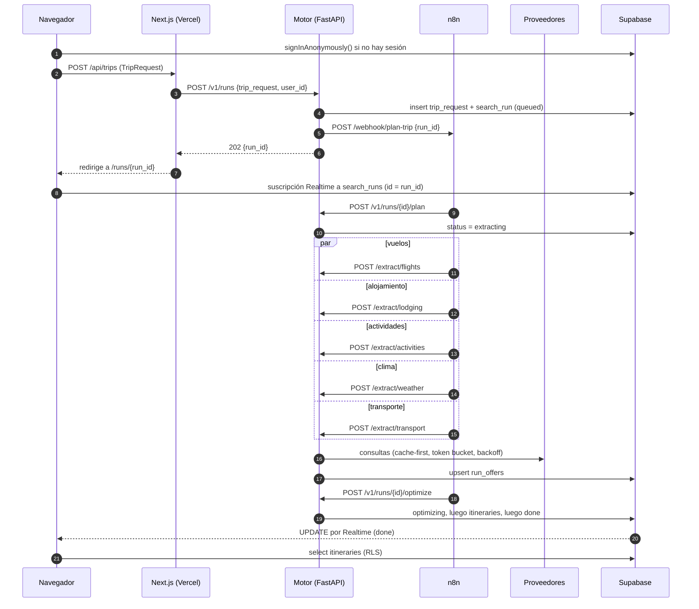
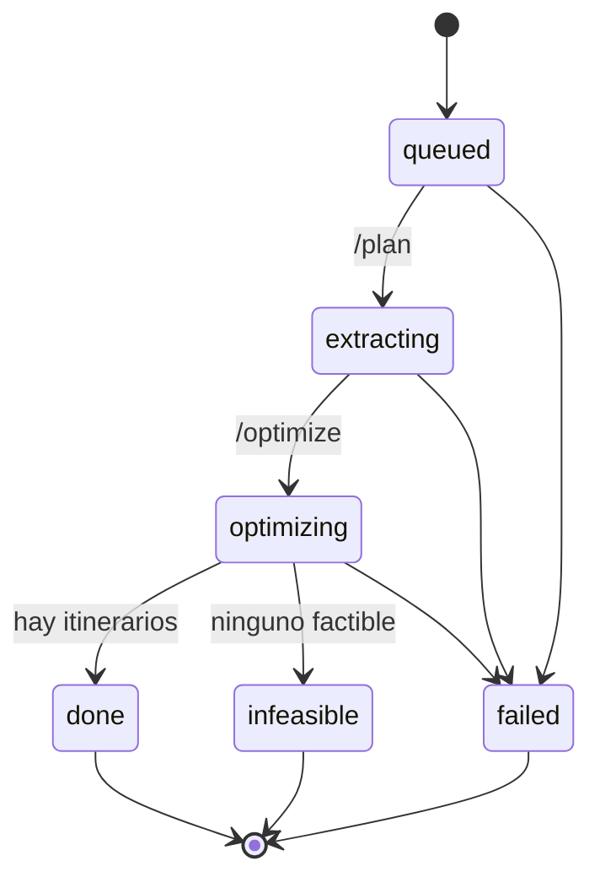

# TravelOpt: plan maestro del MVP

> **Orquestador matemático de viajes.** Recibe parámetros (fechas, destinos, presupuesto, personas y restricciones duras como "mínimo 2 baños"). Consulta proveedores en paralelo y descarta lo que no cumple. Devuelve el itinerario de **menor costo total exacto al centavo**, con calculadora financiera y enlaces de compra.
> No es un recomendador de IA: cada resultado es reproducible, explicable (embudo de descartes) y verificable a mano.

**Documentos del proyecto**

| Documento | Para qué |
|---|---|
| `master_plan.md` | Este archivo: stack, arquitectura, flujo de datos, modelo, seguridad, roadmap |
| `fase_0_entorno_mcp.md` | Entorno local y estructura MCP (cómo trabaja Claude en el repo) |
| `fase_1_extraccion.md` | Contrato de datos, base de datos, proveedores y API de extracción |
| `fase_2_orquestacion_n8n.md` | Workflows de n8n: fan-out paralelo, errores, mantenimiento |
| `fase_3_algoritmo_python.md` | Modelo matemático, CP-SAT, calculadora financiera |
| `fase_4_frontend.md` | Next.js: formulario, estado en tiempo real, resultados |
| `fase_5_deploy.md` | Producción: Supabase, motor, n8n y Vercel con secretos seguros |
| `estado_del_proyecto.md` | Punto de guardado entre sesiones |

## Estado

| Fase | Gate automático | Checks manuales | Fecha | Commit |
|---|---|---|---|---|
| 0 · Entorno + MCP | ✅ | ✅ 11/11 | 2026-10-27 | `30abdf9` |
| 1 · Extracción | ✅ | ✅ 12/13 (CP-1.13: "fixture hasta decidir") | 2026-10-27 | `30abdf9` |
| 2 · n8n | ✅ | ✅ 10/10 (CP-2.9: JSON del repo conservan IDs placeholder a propósito) | 2026-10-27 | `8e990d3` |
| 3 · Algoritmo | ✅ | ✅ 12/12 | 2026-10-27 | `a8d8608` |
| 4 · Frontend | ✅ | ✅ 13/13 | 2026-10-27 | `caac1e2` |
| 5 · Deploy | ✅ gate 5 (2026-11-03) · en producción desde 2026-11-01 (Render + Vercel + Supabase, sin n8n) | ◐ ver `fase_5_deploy.md` | 2026-11-01 | historial de `main` |
| P · Precios vivos ("Fase 2" del roadmap de datos) | ✅ gates 1, 3 y 4 · pgTAP 19/19 · E2E 27/27 | ✅ búsquedas reales verificadas (vuelos, hoteles, eventos) | 2026-11-03 | `44962ce` → major release |
| 6 · Escalabilidad (costo cero) | ⬜ | ⬜ ver `fase_6_escalabilidad.md` | | |

> **Precios vivos (cerrada el 2026-11-03).** Vuelos (Google Flights) y alojamiento (Google Hotels) reales vía SerpApi
> en modo `hybrid`, con caché, presupuesto de 6 búsquedas pagas por consulta, reserva de 20 y modo histórico
> (ADR 0001). Commits: `44962ce` adapter de vuelos · `8d8fc56`/`5656c9b` contrato real · `74af139`/`00cd3b6` hoteles,
> medidor y modo histórico · `b528b1f` presupuesto y caos · `7ad4bfd` entorno 5532x · `aa8beee` pesos, fotos, eventos ·
> major release (carruseles, lugares, rutas, valijas, calendario, links compartidos).
>
> **Aviso legal de SerpApi.** El plan gratuito de SerpApi **no incluye** la cobertura legal ("U.S. Legal Shield") de
> los planes pagos, y los datos derivan de Google (Flights, Hotels, Events), cuyos términos restringen el uso
> automatizado. El sitio se presenta como herramienta gratuita y demostrativa (decisión 3 de `project_guidelines.md`):
> **antes de cualquier uso comercial**, un abogado revisa los términos de SerpApi y de Google, y se evalúa un plan pago
> con cobertura o un proveedor con licencia de distribución.

> El código de todos los documentos se ejecutó antes de escribirlos: 343 tests del motor, el servidor MCP contra el motor real, la lógica de los nodos de n8n con Node y los tests unitarios del frontend. **No se ejecutó** lo que requiere Docker o una cuenta: SQL y pgTAP, n8n real, el build de Next.js, Playwright y el deploy. Cada documento lo marca en su sección de checkpoints.

---

## 1. Principios de diseño

> **Directivas core obligatorias** (seguridad OWASP, clean code, rendimiento y resiliencia): ver
> [`project_guidelines.md`](project_guidelines.md), con su estado de cumplimiento.

1. **El modelo decide, no la IA.** La selección sale de un problema de optimización con restricciones duras explícitas. Cada descarte queda registrado con su motivo.
2. **Exactitud al centavo.** Todo monto es `int` en centavos. Los impuestos van en basis points, con redondeo half-up por línea. La calculadora concilia contra el total del solver y falla si difiere en 1 centavo.
3. **Determinismo.** Misma entrada, misma salida: CP-SAT con un solo worker y desempates explícitos.
4. **Contrato primero.** Un modelo canónico en Pydantic es la fuente de verdad. Cada proveedor se adapta a él (patrón Adapter). El frontend valida contra el mismo contrato, exportado a JSON Schema.
5. **Cache-first y consultas mínimas.** Se consulta solo el conjunto deduplicado que cubre todas las combinaciones. Todo pasa por la caché con un TTL según el tipo de dato.
6. **Escritor único.** Solo el motor escribe en la base. El navegador lee lo suyo con RLS. n8n no conoce credenciales de la base.
7. **Gates de fase.** No se avanza sin `GATE FASE N: OK` y sin los checks manuales tildados.

## 2. Hallazgos que condicionan el diseño (verificados al 26/10/2026)

| Hallazgo | Impacto | Decisión |
|---|---|---|
| **Amadeus cerró su portal Self-Service el 17/07/2026.** Solo queda Enterprise, con contrato. El 03/09/2026 anunció con Anthropic un toolkit para entornos de desarrollo con IA, todavía sin fecha. | La API pedida para vuelos y hoteles no está disponible en self-service | Patrón Adapter. El MVP corre con *fixtures*. Spike de proveedores en la Fase 1 (Duffel, SerpApi Google Flights/Hotels, LiteAPI, Viator) y seguimiento del toolkit de Amadeus |
| Las APIs de hoteles **no informan la cantidad de baños** | La restricción "mínimo 2 baños" no se puede leer directamente | `bathrooms_source` = `explicit` o `inferred_per_room` (1 baño por habitación de hotel). Para alquileres, campo explícito. La UI muestra el origen del dato |
| **NYC Local Law 18:** el alquiler temporario de una unidad completa por menos de 30 días está restringido | Un departamento entero para 5 personas en NYC no es una opción legal | Filtro duro `short_term_legal`. En NYC el óptimo realista son 2 habitaciones de hotel |
| Disney y Universal (Epic Universe) **no tienen API pública de precios** | No hay extracción automática de entradas | Tabla de precios curada por fecha (fixture en el MVP) |
| OpenWeather One Call 3.0 pronostica hasta unos 7 días. Para el histórico pide una llamada por fecha y año | La climatología de un viaje a meses vista costaría cientos de llamadas | Climatología con **Open-Meteo archive**: 10 años en **1 llamada por ciudad**, verificado. OpenWeather queda para el pronóstico cercano. Open-Meteo gratis es de uso no comercial: plan pago antes de lanzar comercialmente |
| El nodo HTTP de n8n ejecuta en paralelo los ítems de un batch, pero las **ramas** se ejecutan en serie | Cinco ramas no son concurrentes | Fan-out con **1 nodo HTTP y 5 ítems**. Se valida en el checkpoint de concurrencia de la Fase 2 |
| SDK de MCP para Python 2.x: `FastMCP` se renombró `MCPServer` | El código de ejemplo de la v1 no corre | El servidor devtools fija `mcp>=2.3,<3` |

## 3. Stack de herramientas (Tarea 1)

| Pieza | Rol | Por qué | Alternativa |
|---|---|---|---|
| **Next.js 16** (App Router, TypeScript) en **Vercel** | UI y BFF: un route handler server-only habla con el motor | SSR y edge globales. Los secretos quedan en el servidor (`server-only`). Deploy con preview por PR | Remix o SvelteKit |
| **Supabase** (Postgres, Auth anónima, Realtime, RLS) | Persistencia, identidad sin registro, push de estado al navegador | Postgres real + RLS + Realtime en un solo servicio. CLI con stack local y migraciones | Neon + Ably |
| **Motor Python 3.12**: FastAPI + Pydantic + **OR-Tools CP-SAT** | *Compute plane*: adapters, caché, rate limit, optimización y finanzas | El ecosistema de optimización está en Python. CP-SAT trabaja con enteros, ideal para centavos exactos | PuLP + CBC, Pyomo |
| **n8n** self-hosted | *Control plane*: dispara, hace el fan-out, reintenta, maneja errores, mantenimiento programado | Observabilidad visual por ejecución, reintentos y cron sin código. Habilita alertas de precio a futuro | Temporal, Inngest |
| **Proveedores** | Fixture (MVP) · Open-Meteo (climatología) · OpenWeather (pronóstico ≤ 7 días) · vuelos, alojamiento y actividades según el spike | Ver §2 | Amadeus Enterprise / toolkit |
| **Tooling** | uv, Supabase CLI, Docker, pytest, ruff, vitest, Playwright, GitHub Actions, gitleaks | Reproducible en Windows y en CI | — |
| **Claude Code + MCP** | Desarrollo asistido con herramientas estandarizadas | Ver §10 y `fase_0_entorno_mcp.md` | — |

### 3.1 Cómo interactúan

- **n8n es el control plane.** Decide *cuándo* y *en qué orden*, y reintenta el transporte. No transforma datos, no toca la base y solo conoce `ENGINE_API_KEY`.
- **El motor es el compute plane.** Decide *qué* consultar (plan mínimo), *cómo* consultar (caché, rate limit, backoff) y *qué conviene* (optimización). Es el único que escribe en Supabase.
- **El navegador nunca espera una petición larga.** `POST /v1/runs` responde `202` enseguida. El progreso llega por Realtime, con sondeo cada 3 s como respaldo. Así ningún timeout de funciones serverless afecta el cálculo.

### 3.2 Mecanismos contra rate-limit y para baja latencia

| # | Mecanismo | Dónde vive | Efecto |
|---|---|---|---|
| 1 | **Plan mínimo de consultas**: deduplica las consultas que piden todos los esqueletos | `optimizer/skeletons.py::build_query_plan` | En el caso de prueba, 6 esqueletos piden solo 9 búsquedas de vuelos, no 18 tramos |
| 2 | **Cache-first con TTL por tipo**: vuelos 30 min, hoteles 6 h, actividades 24 h, pronóstico 3 h, histórico sin vencimiento | `services/cache.py` + tabla `api_cache` | La segunda corrida del clima hizo 0 llamadas externas (verificado) |
| 3 | **Coalescencia**: pedidos idénticos simultáneos comparten una sola llamada | `services/cache.py::cached` | Evita ráfagas duplicadas en el fan-out |
| 4 | **Token bucket por proveedor** | `services/http.py::LIMITERS` | Nunca se excede la cuota contratada |
| 5 | **Backoff exponencial + jitter + `Retry-After`**. Solo reintenta 429/5xx/timeouts; 401/403 fallan enseguida | `services/http.py::fetch_json` | Se recupera de picos sin martillar al proveedor |
| 6 | **Fan-out paralelo**: 5 extracciones concurrentes | n8n (1 nodo HTTP, batch de 5) + `asyncio` | La latencia total es el máximo de las 5, no la suma (test con 5 × 0,5 s < 1,5 s) |
| 7 | **Reintentos donde corresponde**: el motor reintenta al proveedor; n8n solo reintenta si el motor no responde | n8n `neverError` + nodos Code enrutadores | No se multiplican los reintentos (3 × 3 = 9 llamadas) |
| 8 | **Idempotencia**: upsert por `(run_id, kind, offer_id)` y máquina de estados con transiciones condicionales | `repo/postgres.py`, `api/main.py` | Webhooks duplicados y reintentos son inofensivos |
| 9 | **Patrón asíncrono 202 + Realtime** | `api/main.py`, `components/RunView.tsx` | Sin esperas largas en Vercel |
| 10 | **Co-ubicación** en us-east: Supabase East US (N. Virginia), motor y n8n en la misma región, Vercel `iad1` | Fase 5 | Ida y vuelta entre servicios de pocos ms |
| 11 | **Registro de uso por llamada** (proveedor, endpoint sin query, status, latencia) | tabla `api_usage` | Costo y salud por proveedor. Nunca se loguean query params (pueden llevar API keys) |

## 4. Arquitectura



## 5. Flujo de datos



**Máquina de estados de una corrida** (transiciones condicionales en SQL: `UPDATE ... WHERE status = ANY(...)`):



Una corrida que queda colgada más de `STALE_RUN_SECONDS` (600 s por defecto) la marca `failed` el *reaper*, que n8n ejecuta cada 5 minutos.

## 6. Modelo de optimización (resumen; detalle en la Fase 3)

**Esqueleto** $s$ = (orden de ciudades, fecha del primer check-in, noches por ciudad). Cada esqueleto fija los tramos aéreos $\ell$ y las estadías $t$.

$$
\min_{s \in S}\; \Big[\sum_{\ell \in L(s)} \min_{f \in \hat F_\ell} c_f \;+\; \sum_{t \in T(s)} \big( \mathrm{Aloj}^*_t + \mathrm{Act}^*_t + \mathrm{Transp}_t \big) \Big]
$$

- $\hat F_\ell$: vuelos que pasan los filtros duros (escalas, horarios, asientos). Su costo incluye valijas.
- $\mathrm{Aloj}^*_t$: **cobertura entera** de capacidad, baños y dormitorios, eligiendo una sola propiedad (CP-SAT).
- $\mathrm{Act}^*_t$: **asignación actividad→día** con veda climática, capacidad diaria y máximo de días completos seguidos (CP-SAT).

Fijado $s$, los bloques no comparten restricciones. Por eso resolver cada uno a optimalidad y sumar da el **óptimo global exacto**: es una descomposición, no una heurística. Un oráculo de fuerza bruta lo valida en el caso de prueba y en 300 instancias aleatorias.

## 7. Modelo de datos (Supabase)

| Tabla | Contenido | Acceso del navegador |
|---|---|---|
| `trip_requests` | `payload` = `TripRequest` validado | SELECT propio (RLS) |
| `search_runs` | estado, modo, `summary` (plan, embudo, stats), `error`, `timings` | SELECT propio + Realtime |
| `run_offers` | ofertas canónicas por corrida (`kind`, `offer_id`, `payload`) | ninguno |
| `itineraries` | top-N con calculadora financiera completa | SELECT propio |
| `api_cache` | respuestas externas, indexadas por el hash de proveedor + endpoint + params | ninguno |
| `api_usage` | una fila por llamada externa | ninguno |

Esquema completo, RLS, grants y pruebas pgTAP en `fase_1_extraccion.md`.

## 8. Seguridad y secretos

| Secreto | Quién lo usa | Dónde vive | Nunca en |
|---|---|---|---|
| `ENGINE_API_KEY` | Route handler de Next.js, n8n, devtools local | Vercel (Sensitive), credencial de n8n, `.env` local | `NEXT_PUBLIC_*`, repo, logs |
| `N8N_WEBHOOK_SECRET` | Motor (emisor) y n8n (Header Auth) | Variables del motor, credencial de n8n | Frontend |
| `DATABASE_URL` (contraseña de Postgres) | Motor | Variables del host del motor | n8n, frontend |
| Publishable key de Supabase | Navegador | `NEXT_PUBLIC_SUPABASE_PUBLISHABLE_KEY` | — (es pública por diseño; la protege RLS) |
| Secret key de Supabase | Nadie en el MVP | Panel de Supabase | Cualquier otro lugar |
| `N8N_ENCRYPTION_KEY` | n8n (cifra credenciales) | Variables de n8n + **copia offline** | Repo |
| `N8N_API_KEY` | Devtools (solo local) | `.env` local | Producción |
| `OPENWEATHER_API_KEY` | Motor | Variables del motor | Logs y claves de caché (se excluye del hash) |
| Tokens OAuth de MCP (Supabase, n8n) | Claude Code | Scope **local** de Claude Code | `.mcp.json` del repo |

Defensas en capas:
- RLS más `revoke` de escritura para `anon` y `authenticated`.
- `import "server-only"` en el código que usa secretos.
- Scan del bundle del cliente (`gate.py`) y gitleaks en CI.
- Reglas `deny` de lectura de `.env` para Claude.
- Endpoints `/v1/dev/*` deshabilitados en producción.

## 9. Estructura del repositorio

```text
travelopt/
├── CLAUDE.md                     # reglas para Claude
├── master_plan.md · fase_*.md · estado_del_proyecto.md
├── .mcp.json                     # servidores MCP del proyecto (sin secretos)
├── .claude/settings.json         # permisos de Claude Code
├── .env.example                  # .env real: ignorado por git
├── docker-compose.yml            # n8n local
├── contracts/                    # JSON Schema exportado desde Pydantic
├── engine/                       # motor Python (uv)
│   ├── app/
│   │   ├── domain/               # models.py (contrato) · money.py
│   │   ├── optimizer/            # skeletons · filters · lodging · activities · oracle · solver · finance · service
│   │   ├── providers/            # base · fixture · weather · registry
│   │   ├── services/             # http (rate limit, retry) · cache
│   │   ├── repo/                 # base · memory · postgres
│   │   ├── api/main.py           # FastAPI
│   │   ├── settings.py · cli.py
│   ├── fixtures/orlando_nyc_5pax/
│   ├── scripts/export_contracts.py
│   ├── tests/
│   ├── Dockerfile · pyproject.toml · uv.lock
├── n8n/workflows/                # WF-01..03 exportados (JSON)
├── supabase/                     # config.toml · migrations/ · tests/database/
├── tools/devtools_mcp/           # servidor MCP de pruebas
├── web/                          # Next.js
├── scripts/gate.py               # gates de fase
└── .github/workflows/ci.yml
```

## 10. Estructura MCP (Tarea 2; detalle y archivos en la Fase 0)

| Servidor | Transporte | Scope | Para qué | Límite |
|---|---|---|---|---|
| `travelopt-devtools` (propio) | stdio (`uv run`) | Proyecto (`.mcp.json`) | Crear corridas, extraer, correr end-to-end, disparar webhooks, leer ejecuciones de n8n y comparar con el golden | Solo hosts locales, salvo `DEVTOOLS_ALLOW_REMOTE=1` |
| `supabase-local` | HTTP `localhost:54321/mcp` | Proyecto | Inspeccionar esquema y datos del stack local | Sin DDL: los cambios van en `supabase/migrations/` |
| `n8n` (MCP de instancia) | HTTP + token | **Local** (`claude mcp add --scope local`) | Descubrir y ejecutar workflows publicados | Opcional |
| `supabase-staging` | HTTP `mcp.supabase.com` + OAuth | **Local** | Leer esquema, logs y advisors de staging | `read_only=true`. Producción nunca por MCP |

## 11. Caso de prueba hardcodeado (golden)

| Parámetro | Valor |
|---|---|
| Grupo | 5 adultos, 1 valija despachada cada uno |
| Ruta | EZE → Orlando (MCO) → Nueva York (JFK/LGA/EWR) → EZE. El origen EZE es un supuesto editable |
| Fechas | Primer check-in 08 o 09/07/2027 · 12 noches · Orlando 6–8 · NYC 4–6 |
| Obligatorias | Orlando: Magic Kingdom, EPCOT, Hollywood Studios, Animal Kingdom, Epic Universe · NYC: Estatua de la Libertad, Top of the Rock, MoMA |
| Restricciones | ≥ 2 baños · ≤ 1 escala · salida ≥ 06:00 · llegada ≤ 23:00 · P(lluvia fuerte) ≤ 0,5 en actividades outdoor · ≤ 3 días de parque seguidos |
| Presupuesto | USD 21,000.00 |

**Resultado esperado (verificado con CP-SAT, fuerza bruta y a mano):**

| Ítem | Valor |
|---|---|
| Óptimo | **USD 20,083.62**: check-in 08/07, 8 noches en Orlando y 4 en NYC (`ORL-NYC\|2027-07-08\|8-4`) |
| Por categoría | vuelos 10,485.00 · alojamiento 3,556.62 · actividades 5,080.00 · transporte 962.00 |
| Por persona | 4,016.73 · 4,016.73 · 4,016.72 · 4,016.72 · 4,016.72 (la suma da exacto) |
| Alternativas | #2 USD 20,423.78 · #3 USD 21,108.78 |
| Embudo | 4 de 6 esqueletos factibles. Los 2 de 6 noches en Orlando no entran: 5 parques en 4 días útiles por la lluvia del 12/07. Se descartan 6 ofertas por baños, 4 alquileres ilegales en NYC y 7 días-actividad por lluvia |

El óptimo no es obvio: **más noches en Orlando abaratan el total** porque reducen noches caras en NYC, permiten un vuelo MCO→NYC más barato y evitan un parque en fin de semana.

## 12. Roadmap

| Fase | Objetivo | Entregables | Gate (resumen) |
|---|---|---|---|
| **0** Entorno + MCP | Máquina lista y Claude con herramientas estandarizadas | Docker, uv, Supabase y n8n locales, `.mcp.json`, devtools, permisos, `CLAUDE.md` | Servicios arriba, `claude mcp list` conectado, deny de `.env` efectivo |
| **1** Extracción | Datos canónicos persistidos y API de extracción | Migración + pgTAP, motor en modo fixture/hybrid, spike de proveedores | 29 tests · pgTAP 8/8 · conteos en DB 15/48/99/14/2 (57 antes del catálogo de 4b) · clima real con caché |
| **2** n8n | Orquestación robusta | WF-01 plan-trip, WF-02 errores, WF-03 mantenimiento | Concurrencia ≈ máx. y no suma · webhook duplicado inofensivo · motor caído → `failed` · 501 → `failed` (esperado) |
| **3** Algoritmo | Óptimo exacto y explicable | Optimizador, calculadora, servicio | 343 tests · CLI = golden · E2E vía n8n `done` con USD 20,083.62 |
| **4** Frontend | UX con calculadora y estado en vivo | App Next.js | lint, typecheck y build · bundle sin secretos · e2e 3/3 · RLS entre usuarios |
| **5** Deploy | Producción segura | Supabase, motor, n8n y Vercel en producción, CI | Smoke en producción · advisors sin errores · secretos auditados · rollback probado |

**Backlog post-MVP:**
- adapters live de vuelos, alojamiento y actividades;
- tickets multi-día de parques como SKU agregado;
- tarifas por noche variables;
- conversión de moneda y recargos por pago configurables;
- alertas de cambio de precio (cron de n8n sobre búsquedas guardadas);
- orden de ciudades libre (`fixed_order=false`, ya soportado por el motor);
- rate limiter compartido (Redis) para escalar el motor horizontalmente;
- penalización climática suave (λ);
- cuentas con email y exportación a PDF.

## 13. Riesgos y mitigaciones

| Riesgo | Mitigación |
|---|---|
| Acceso a proveedores (Amadeus cerrado, programas de partners) | Adapter + fixture + spike con matriz de decisión. El resto del sistema no depende del proveedor |
| Términos de uso de APIs de scraping (SerpApi) | Revisión legal antes de producción. Preferir APIs oficiales o de partners |
| El precio cambia entre la búsqueda y la compra | TTL corto, timestamp visible, aviso de "precio indicativo" y deeplink a la oferta |
| Baños inferidos erróneamente | `bathrooms_source` visible en la UI. Para alquileres, campo explícito |
| Costos y cuotas de las APIs | Caché, token bucket, ledger `api_usage`, tope diario en el panel de cada proveedor |
| El supuesto de paralelismo en n8n | Checkpoint de concurrencia medido (Fase 2) |
| Escala del solver | Descomposición + memo + límite de tiempo. Flag `all_subproblems_optimal` |
| Timeouts serverless | Patrón 202 + Realtime |
| Fuga de secretos | `server-only`, scan del bundle, gitleaks, reglas deny, scopes MCP locales |
| Licencia de Open-Meteo (no comercial) | Plan pago u OpenWeather antes de lanzar comercialmente |
| Regulaciones locales de alquiler | Filtro `short_term_legal`, con lista curada por ciudad |

## 14. Convenciones

- **Dinero:** sufijo `_minor`, `int` en centavos y moneda `USD` en el MVP. Formato `USD 20,083.62` igual en Python y en TypeScript.
- **Fechas:** ISO `YYYY-MM-DD`. Las horas de vuelo son locales del aeropuerto (sin zona). Los días de actividad son locales de la ciudad.
- **IDs:** UUID para corridas. IDs de oferta estables y deterministas (p. ej. `H2@2027-07-08/2027-07-16`).
- **Motivos de descarte:** `categoria.motivo` (`lodging.bathrooms`, `flight.too_many_stops`…).
- **Migraciones:** `supabase/migrations/<timestamp>_<nombre>.sql`. Solo hacia adelante: para revertir se escribe una migración nueva.
- **Commits:** un gate por commit de cierre de fase (`fase-1: gate OK`).

## 15. Fuentes

- Cierre de Amadeus Self-Service: [PhocusWire](https://www.phocuswire.com/amadeus-shut-down-self-service-apis-portal-developers) · [AirLabs](https://airlabs.co/amadeus-self-service-api-shutdown)
- Amadeus y Anthropic: [Travolution](https://www.travolution.com/news/technology/amadeus-pairs-up-with-anthropic-for-developers-access-to-content/) · [Blog de Amadeus](https://amadeus.com/en/blog/articles/anthropic-trusted-travel-intelligence-ai-agents)
- MCP de Supabase (remoto y local): [Changelog](https://supabase.com/changelog/39434-supabase-remote-mcp-server) · [supabase/mcp](https://github.com/supabase/mcp)
- MCP de instancia de n8n: [Automation Atlas](https://automationatlas.io/answers/can-you-build-n8n-workflows-with-claude-code/) · [WikiDocs](https://wikidocs.net/333593)
- Migración del SDK MCP 2.x: [py.sdk.modelcontextprotocol.io](https://py.sdk.modelcontextprotocol.io/v2/migration/#fastmcp-renamed-to-mcpserver)
- APIs de clima: [OpenWeather One Call 3.0](https://openweathermap.org/api/one-call-3) · [Open-Meteo Historical Weather](https://open-meteo.com/en/docs/historical-weather-api)
- NYC Local Law 18: [Office of Special Enforcement](https://www.nyc.gov/site/specialenforcement/registration-law/registration.page)
